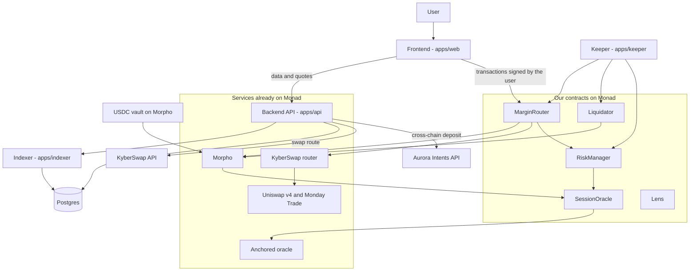
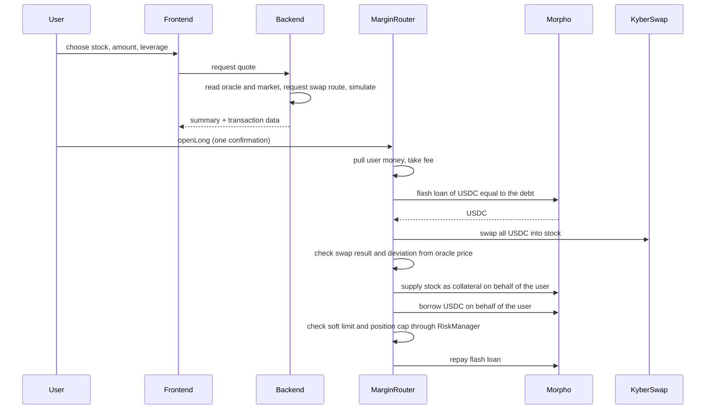

# 02. Architecture

## Big picture



## The parts

### Contracts (Wangsit)

| Contract | Its job | Notes |
|---|---|---|
| `SessionOracle` | Reads the price and market session from the Anchored oracle, then gives it to Morpho in the form Morpho asks for | One per market. Cannot be changed after deployment |
| `RiskManager` | Stores the soft limit, position cap, market close schedule, and the stop switch. Checks every position opening | The numbers can be changed through the multisig with a timelock |
| `MarginRouter` | The user's entry point: open and close long and short, add and take collateral, auto-deleverage | Does not hold funds. Cannot be changed after deployment |
| `Lens` | Reads all of a user's positions in one call | Read only |
| `Liquidator` | Liquidates unhealthy positions in our markets, using flash loans and an exchange | Can only be called by our keeper |

What we do not write but we deploy and configure: the markets on Morpho, and the USDC vault from Morpho's own vault factory.

### Backend (Dharu)

| Service | Its job |
|---|---|
| `apps/api` | Provides market data, full transaction quotes with their call data, account data, cross-chain deposits, alerts, region checks |
| `apps/indexer` | Reads events from our contracts and from Morpho, then stores them as positions and history |
| `apps/keeper` | Programs that run all the time: calendar poster for market closes, oracle age poster, protector (auto-deleverage), liquidator bot, alert sender, oracle monitor |

### Frontend (Nabil)

| Page | Contents |
|---|---|
| Markets | List of stocks: price, market session, limits, interest |
| Market detail | Market depth, DEX-to-oracle deviation, interest history |
| Trade | Long and Short form with a summary before confirmation |
| Positions | Positions, health, profit and loss, history, actions |
| Earn | Lend USDC or stocks, withdraw deposits |
| Deposit and Withdraw | Cross-chain |
| Settings | Automatic protection, alerts |
| Help | Risk explanation, FAQ, terms of use |

The landing page is not part of `apps/web`. It is a separate site in `apps/landing` on the root domain, while the app runs on the `app.` subdomain (D-37). In the app, `/` opens Markets.

## Where user funds are

This is the most important decision in the design (D-02).

- Collateral and debt are recorded under the user's own address on Morpho.
- `MarginRouter` is only given authorization by the user to act on their behalf on Morpho (`setAuthorization`). The user can revoke that authorization at any time, directly on Morpho, without our help.
- Between two transactions, `MarginRouter` holds no tokens.
- The team has no way to take user funds. The most the team can do is stop the opening of new positions.

The result: if our app and backend go down, users can still close their positions directly on Morpho.

## Order of steps inside one transaction

All flows use flash loans from Morpho, which are free. A flash loan is a loan that must be repaid in the same transaction.

### Open long



### Close long

1. Flash loan of USDC equal to the debt to be repaid.
2. Repay the debt on behalf of the user.
3. Withdraw the collateral stock.
4. Swap the stock into USDC.
5. Repay the flash loan.
6. Send the remaining USDC to the user.

### Open short

1. Pull the USDC collateral from the user, take the fee.
2. Flash loan of USDC equal to the guaranteed minimum sale proceeds.
3. Supply the USDC collateral plus that flash loan on behalf of the user.
4. Borrow stock on behalf of the user.
5. Swap the stock into USDC.
6. Repay the flash loan from the sale proceeds. The excess is supplied as extra collateral.
7. Check the soft limit and position cap.

### Close short

1. Flash loan of USDC just enough to buy back the stock.
2. Swap USDC into stock, slightly more than the debt so it is sure to be enough.
3. Repay the stock debt on behalf of the user.
4. Withdraw the USDC collateral.
5. Repay the flash loan.
6. Send the remaining USDC and the very small leftover stock to the user.

### Auto-deleverage

Same as close long or close short, but only partial, called by the keeper, and only when three conditions are met: the user has turned on protection, their LTV is above the soft limit at that time, and the swap price does not deviate from the oracle price by more than allowed.

## Who is trusted for what

| Party | Trusted for | If it is malicious or broken |
|---|---|---|
| Our contracts | Running the steps correctly | Biggest risk: the router holds authorization from many users. See the threat list in 07 |
| Backend | Building good swap routes | Cannot steal. The minimum swap output is signed by the user, and the contract rejects prices that deviate too far from the oracle |
| Keeper | Running protection and liquidation on time | Cannot take funds. If it goes down, automatic protection does not run, but the hard limit on Morpho still works |
| Team multisig | Setting the soft limit and position cap | Cannot touch funds. Can stop the opening of new positions |
| Anchored oracle | Stock price and market session | Weakest point. Controlled by one party and can be changed by them. See 04 and 07 |
| Anchored as issuer | Not blocking Morpho addresses or pausing the token | If blocked, collateral can be locked. See Q-05 |
| Morpho, Uniswap, Monday Trade, KyberSwap | Working as usual | Risk we inherit |

## Repo layout

One repo for everything (monorepo), managed with pnpm and Turborepo.

```
/
├── contracts/            Wangsit. Foundry
│   ├── src/              contracts and interfaces
│   ├── test/             unit tests, fork tests, invariant tests
│   ├── script/           deployment scripts
│   └── deployments/      deployed addresses: fork.json, monad.json
├── apps/
│   ├── api/              Dharu. API
│   ├── indexer/          Dharu. Event reader
│   ├── keeper/           Dharu. Keeper
│   └── web/              Nabil. Web app
├── packages/
│   ├── db/               Dharu. Postgres schema and migrations (Drizzle), used by api, indexer and keeper
│   ├── kyber/            Dharu. KyberSwap client and the DEX mid price (D-36), used by api and keeper
│   └── shared/           Shared, each file has an owner
│       ├── abis/         generated from contracts/, do not edit by hand
│       ├── addresses.ts  addresses of external services and our contracts
│       ├── markets.ts    list of markets and their numbers
│       ├── math.ts       formulas for limits, liquidation price, leverage
│       └── api/          API data shapes (zod schemas)
└── docs/                 these docs
```

## Default technology

This is the initial choice (D-10). The owner of a part may replace it, as long as it is recorded in 09 and does not change the agreements in 03.

| Part | Choice |
|---|---|
| Contracts | Solidity 0.8.x, Foundry, OpenZeppelin, official Morpho interfaces |
| Backend | Node.js 24, TypeScript, Hono, Postgres with Drizzle, viem, zod |
| Indexer | Our own log follower in `apps/indexer`, reading from Envio HyperSync with the RPC endpoint as fallback (D-34) |
| Frontend | Next.js App Router, TypeScript, Tailwind, wagmi and viem, TanStack Query |
| Wallet | Plain wallets through wagmi, plus sign-in by email or passkey through Privy (D-16, D-22) |
| Tests | Foundry (contracts), Vitest (backend and formulas), Playwright (on-screen flows) |
| Automation | GitHub Actions: tests, type checks, and style checks on every PR |

## Work environments

The protocols we use (Morpho, Anchored tokens, markets on Uniswap) exist only on Monad mainnet. So there is no useful testnet for us.

| Environment | What | Used for |
|---|---|---|
| Local fork | A copy of Monad mainnet on your own computer (Anvil), with our contracts deployed by a script | Developing and testing without real money, with real market conditions |
| Mainnet, staging | Our contracts on mainnet with a very small position cap and the team's own money | Proving the flows with real transactions |
| Mainnet, production | Final deployment after the audit, owned by the multisig | General users |

How to work without waiting for each other:

- **Reading data.** Frontend and backend can read the Anchored oracle, Morpho, and KyberSwap quotes from mainnet from day one. No mock data is needed.
- **Writing transactions.** Once Wangsit finishes the interfaces (SC-03), the ABIs are available in `packages/shared/abis`. Frontend and backend build against those ABIs. Once the contracts can be deployed on the local fork, the `make fork` command gives everyone the same environment.
- **Addresses.** The deployment script writes addresses to `contracts/deployments/*.json`. `packages/shared/addresses.ts` reads them. No one copies addresses by hand.

Whether Anvil can copy Monad well is not verified. That is task SC-02.

## Monad specifics that affect the design

| Item | Effect |
|---|---|
| Fees are charged on the gas limit, not on gas used | The backend must give a gas limit from simulation with a small margin. Do not use the wallet's excessive default |
| 300 millisecond blocks, final in 600 milliseconds | The UI can update positions almost instantly. Quotes go stale quickly, so give them a short validity |
| Public RPC endpoints have limits | `rpc2.monad.xyz` allows 300 requests per 10 seconds and a range of 10,000 blocks for reading events. Production uses a paid provider |
| Receipts report gas used equal to the gas limit | Do not measure gas use from receipts. Use simulation |
